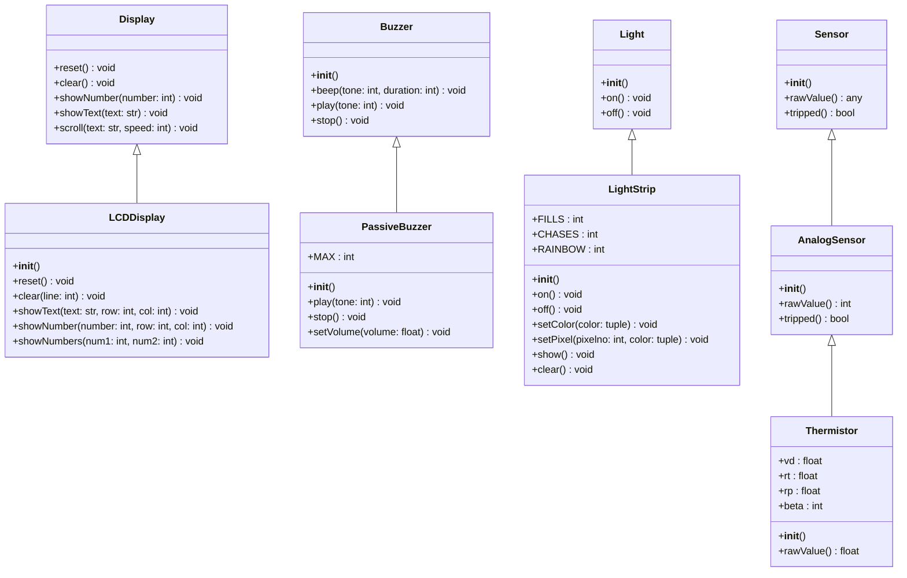

# Mini Lab 1: Class Diagram

This class diagram models the four target peripheral classes from **Mini Lab 1** (`LCDDisplay`, `PassiveBuzzer`, `LightStrip`, and `AnalogSensor`) along with all their immediate superclasses and subclasses.

> [!TIP]
> **Exported Diagram Available**: A standalone vector graphic version of this diagram has been exported as [`class-diagram.svg`](file:///c:/Users/mmsho/Documents/GitHub/PicoLibrary/MiniLab1-Michele/class-diagram.svg).

## Scope & Design Decisions

* **Target Classes**:
  * `LCDDisplay` (from `Displays.py`)
  * `PassiveBuzzer` (from `Buzzer.py`)
  * `LightStrip` (from `LightStrip.py`)
  * `AnalogSensor` (from `Sensors.py`)
* **Immediate Superclasses**:
  * `Display` (superclass of `LCDDisplay`)
  * `Buzzer` (superclass of `PassiveBuzzer`)
  * `Light` (superclass of `LightStrip`, from imported dependency `Lights.py`)
  * `Sensor` (superclass of `AnalogSensor`)
* **Immediate Subclasses**:
  * `Thermistor` (subclass of `AnalogSensor`)
* **Page-Fitting Optimizations**:
  * Constructor parameter lists are omitted (`+__init__()`) to prevent horizontal box stretching and ensure the diagram fits readably on one standard printed page (8.5" × 11"). Detailed constructor signatures are provided in the reference table below.
  * Files starting with a lowercase letter (`gpio_lcd.py`, `lcd_api.py`, `pico_i2c_lcd.py`) and standard library packages (`time`, `machine`) are excluded.
  * Sibling classes (`ActiveBuzzer`, `DigitalSensor`, `TiltSensor`) and uninherited application classes are excluded.

## Hierarchy & Constructor Details

| Target Class | Immediate Superclass | Immediate Subclass | Constructor Signature (`__init__`) | Key Public Methods / Attributes |
| :--- | :--- | :--- | :--- | :--- |
| **`LCDDisplay`** | `Display` | *None* | `(rs=5, e=4, d4=3, d5=2, d6=1, d7=0, *, sda=-1, scl=-1)` | `showText()`, `showNumber()`, `clear()`, `reset()` |
| **`PassiveBuzzer`** | `Buzzer` | *None* | `(pin, name='Buzzer')` | `play()`, `stop()`, `setVolume()`, `MAX` |
| **`LightStrip`** | `Light` | *None* | `(pin=2, name='Neopixel', numleds=16, brightness=0.5)` | `setPixel()`, `setColor()`, `show()`, `on()`, `off()` |
| **`AnalogSensor`** | `Sensor` | `Thermistor` | `(pin, name='Analog Sensor', lowActive=True, threshold=30000)` | `rawValue()`, `tripped()` |
| *`Thermistor`* | `AnalogSensor` | *None* | `(pin, name='Thermistor', lowActive=False, threshold=30, Vd=3.3, Rp=10, Rt=10, beta=3950)` | `rawValue()` |

> [!NOTE]
> In `Sensors.py`, `Thermistor` also implements `TemperatureSensor` via multiple inheritance (`class Thermistor(AnalogSensor, TemperatureSensor)`). Only `AnalogSensor` is depicted as its primary parent to focus on the four required classes and keep the diagram cleanly readable on one printed page.
